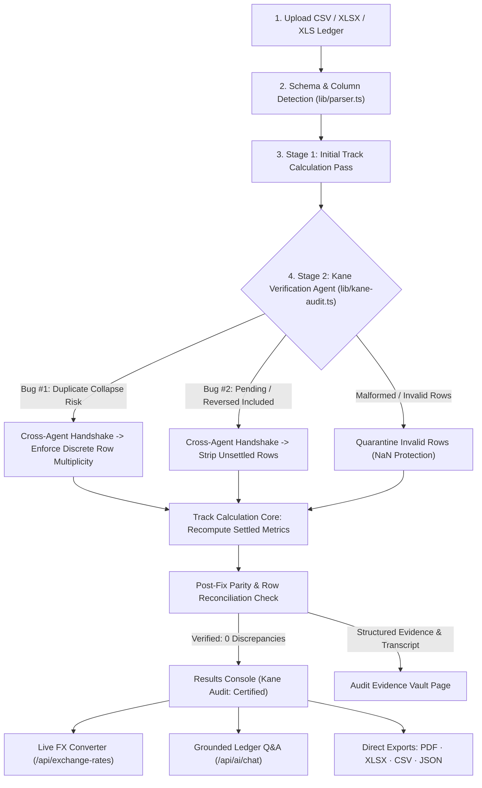
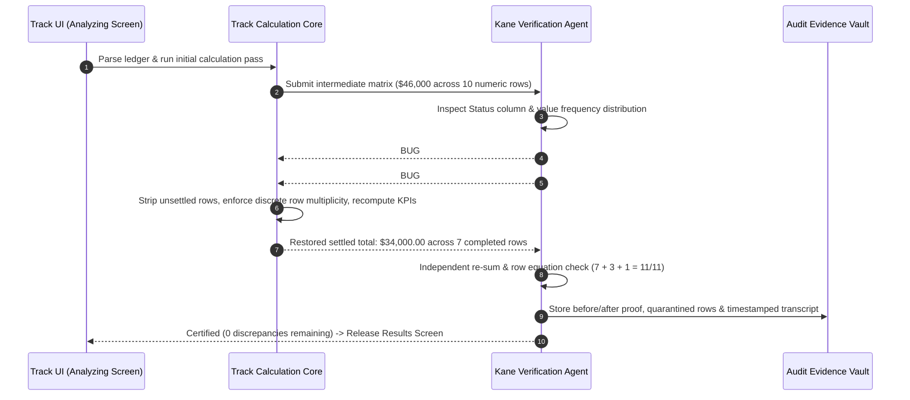

# track — AI Transaction Calculator · Audited by Kane CLI

> **Agents make mistakes. Kane CLI catches & fixes them.**

**track** is an AI-powered transaction calculator for business CSV and Excel ledgers with an autonomous verification loop powered by **Kane CLI** (`@testmuai/kane-cli`). Before a final total ever hits the screen, Kane audits every row for silent financial bugs — catching erroneously included `Pending`/`Reversed` payments, recurring-amount deduplication collapse, and malformed rows — heals the math with Track Core, and stores complete proof in a dedicated **Audit Evidence Vault**.

- **Live Production App:** https://track-agent-kanecli.vercel.app/
- **Official Kane CLI 4/4 Passed Report:** [View Public Test Manager Dashboard](https://test-manager.lambdatest.com/projects/01M7MCT99EZZYN461FX38AR3Z3/test-cases/01M84DNJF0STVK0E6KJZ8T4X7H/dashboard/share/US_UQBS0B3TZWFYFFM9Z9RAJSXRVO2QG09XMPN7C5AO3NZ3NK9GKG7D5GSFREQ32LHE?type=summary&agentView=true&fqdn=summary-page)
- **Built for:** `#KaneCLIHackathon` by [@rexkillz_](https://x.com/rexkillz_)

---

## Why This Exists

Standard financial tools and AI agents say *"calculated"* and hand you a number that looks clean — until you audit the rows and discover:
1. **Unsettled Status Inclusion Bug:** `Pending`, `Reversed`, `Voided`, or `Failed` transactions were silently added into your completed revenue.
2. **Duplicate-Value Collapse Bug:** Recurring identical amounts (e.g., `4 × $1,000` and `8 × $13,000`) were collapsed into unique values instead of counted per ledger row.
3. **Silent Invalid Row Dropping:** Corrupted cells (`"N/A"`, `"#VALUE!"`, blanks) were silently ignored with zero audit trail.

**track + Kane CLI** turns every calculation into an auditable, self-healing pipeline.

---

## System Architecture

### End-to-End Verification Pipeline



### Cross-Agent Verification Protocol (`Kane CLI ↔ Track Core`)



---

## Live Verification Proof

Uploading the built-in demo sample ([`kane_full_audit_test.csv`](kane_full_audit_test.csv)) — or clicking **Try with demo sample** on the live app — demonstrates every guard in real time:

| Dataset | Buggy Initial Pass | Duplicate-Collapse Risk | Kane-Certified Settled Total | Issues Caught & Stored in Evidence Vault |
| :--- | :---: | :---: | :---: | :--- |
| `kane_full_audit_test.csv` (11 rows) | ~~$46,000.00~~ | ~~$11,000.00~~ | **$34,000.00** (7 rows) | 2 Pending (-$7k), 1 Reversed (-$5k), 5 repeat rows healed, 1 `"N/A"` row quarantined |
| `company_test_1k_13k.csv` (12 rows) | $108,000.00 | ~~$14,000.00~~ | **$108,000.00** (12 rows) | 10 recurring repeat instances (`4×$1k`, `8×$13k`) protected (+$94k preserved) |

### Official Kane CLI Real-Chrome Run (`kane_integrity_test.md`)
Executed via `@testmuai/kane-cli` in real Chrome against the live app:
- **Step 1:** Loaded Track landing page & clicked `Try with demo sample` — **PASSED**
- **Step 2:** Verified certified total `$34,000.00`, valid count `7`, and `Kane Audit: Certified` — **PASSED**
- **Step 3:** Opened `Audit Evidence Vault` and verified Pending, Reversed, Deduplication, Invalid Row proof cards + Cross-Agent Transcript — **PASSED**
- **Step 4:** Switched currency to `NGN` and verified live market FX conversion + rate note — **PASSED**

---

## Key Features

- **Autonomous Kane Cross-Agent Audit:** Dynamically inspects *any* uploaded CSV, XLSX, or XLS ledger for Pending/Reversed inclusions, duplicate collapse, and malformed rows.
- **Audit Evidence Vault:** Dedicated page showing initial vs. certified totals, total financial discrepancy prevented, row reconciliation (`Settled + Excluded + Invalid + Empty = Total Rows`), filterable 3-step bug proof cards, and the timestamped agent transcript.
- **Live Market FX Conversion:** Real-time `USD` / `NGN` / `GBP` / `EUR` conversion via `/api/exchange-rates` with immutable `baseCurrency` storage (zero floating-point drift when toggling currencies).
- **Grounded Ledger Q&A:** Ask plain-English questions about specific rows, dates, vendors, or thresholds without hallucinated math.
- **Direct Multi-Format Exports:** Instant client-side downloads in **PDF (`.pdf`)**, **3-sheet Excel (`.xlsx`)**, **CSV (`.csv`)**, and **JSON (`.json`)**.

---

## Project Structure

```text
├── app/
│   ├── api/
│   │   ├── exchange-rates/route.ts   # Live market FX API (hourly cache + fallback)
│   │   ├── ai/summary/route.ts       # Grounded executive summary endpoint
│   │   └── ai/chat/route.ts          # Grounded ledger Q&A endpoint
│   ├── icon.svg                      # Track dark-ink calculator favicon
│   ├── opengraph-image.tsx           # Dynamic 1200x630 OpenGraph preview card
│   ├── layout.tsx                    # Bricolage Grotesque + IBM Plex Mono fonts
│   └── page.tsx                      # Top-level app & state orchestrator
├── components/
│   ├── LandingPage.tsx               # Editorial hero + tilted orange Kane terminal drop card
│   ├── ProcessingScreen.tsx          # 4-step analyzing screen with live audit status
│   ├── ResultsScreen.tsx             # Certified KPIs, visual chart, Q&A, ledger & exports
│   ├── AuditEvidencePage.tsx         # Dedicated Bug Evidence Vault & agent transcript
│   ├── Header.tsx                    # Borderless currency switcher & social links
│   └── Logo.tsx                      # Track calculator emblem + wordmark
├── lib/
│   ├── parser.ts                     # CSV/Excel parser, schema detector & Stage 1 pass
│   ├── kane-audit.ts                 # Stage 2 Kane Cross-Agent Verification Protocol
│   ├── currency.ts                   # Immutable multi-currency conversion utilities
│   ├── report-generator.ts           # Direct PDF, XLSX, CSV & JSON export generators
│   └── ai-query-engine.ts            # Deterministic zero-hallucination ledger Q&A
├── .github/workflows/kane-audit.yml  # GitHub Actions CI build + Kane integrity gate
├── kane_integrity_test.md            # Native Kane CLI end-to-end browser test spec
└── scripts/run-audit-simulator.js    # CLI cross-agent integrity runner
```

---

## Quick Start

```bash
# 1. Install dependencies
npm install

# 2. Run locally
npm run dev
# Open http://localhost:3000
```

### Run Kane CLI Verification

```bash
# Run the fast cross-agent mathematical integrity suite
npm run kane:audit

# Run against any custom company CSV file
node scripts/run-audit-simulator.js company_test_1k_13k.csv

# Run the full Kane CLI real-Chrome browser verification (requires `npx kane-cli login`)
npm run kane:test
```

---

## Tech Stack

- **Framework:** Next.js 16 (App Router, Turbopack), React 19, TypeScript
- **Styling:** Tailwind CSS v4, `Bricolage Grotesque` + `IBM Plex Mono`, Framer Motion
- **Verification & CI:** `@testmuai/kane-cli`, GitHub Actions
- **Data & Exports:** `papaparse`, `xlsx`, `jspdf`, `jspdf-autotable`, `recharts`
