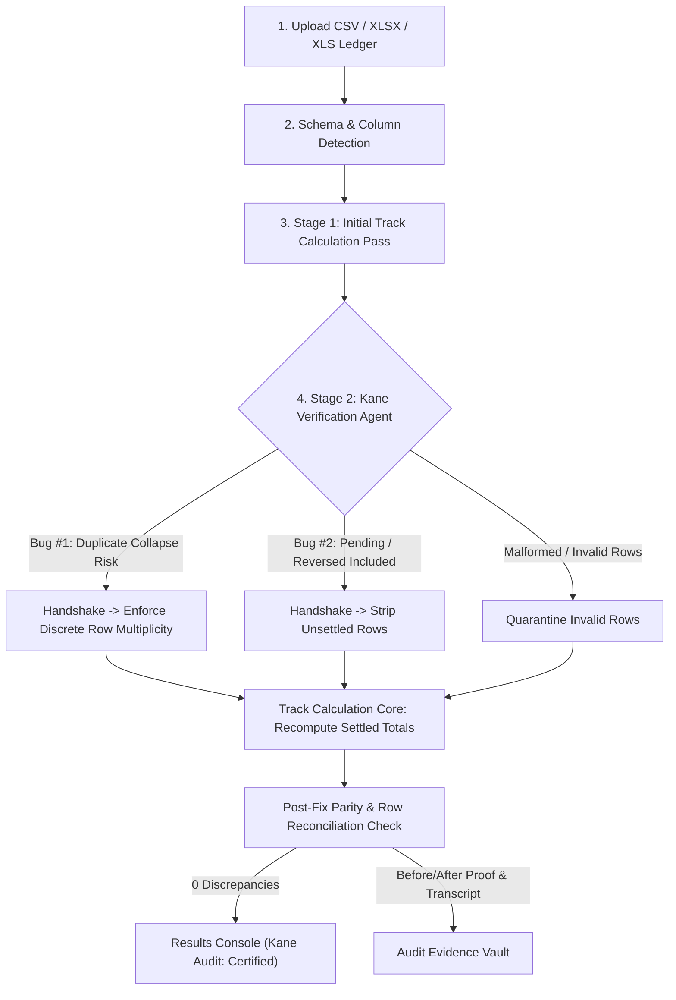
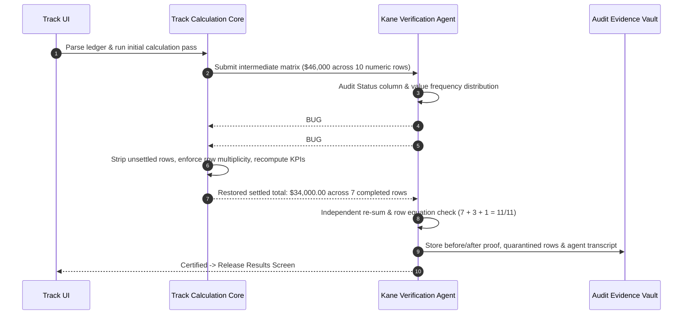

# track — AI Transaction Calculator · Audited by Kane CLI

> **Agents make mistakes. Kane CLI catches & fixes them.**

**track** is an AI transaction calculator for business CSV and Excel ledgers with an autonomous verification loop powered by **Kane CLI** (`@testmuai/kane-cli`). Before a final total ever hits the screen, Kane audits every row for silent financial bugs — catching erroneously included `Pending`/`Reversed` payments, duplicate-value collapse, and malformed rows — heals the math with Track Core, and stores complete proof in a dedicated **Audit Evidence Vault**.

- **Live App:** https://track-agent-kanecli.vercel.app/
- **Kane CLI 4/4 Passed Report:** [View Public Test Manager Dashboard](https://test-manager.lambdatest.com/projects/01M7MCT99EZZYN461FX38AR3Z3/test-cases/01M84DNJF0STVK0E6KJZ8T4X7H/dashboard/share/US_UQBS0B3TZWFYFFM9Z9RAJSXRVO2QG09XMPN7C5AO3NZ3NK9GKG7D5GSFREQ32LHE?type=summary&agentView=true&fqdn=summary-page)
- **Built for:** `#KaneCLIHackathon` by [@rexkillz_](https://x.com/rexkillz_)

---

## The Problem

Financial tools and AI agents often return totals that look clean — until you audit the spreadsheet and find:
1. **Pending & Reversed rows added to revenue** instead of excluded as unsettled.
2. **Recurring identical amounts collapsed** (e.g., `4 × $1,000` and `8 × $13,000` counted once instead of per row).
3. **Malformed rows silently dropped** (`"N/A"`, blanks) with no audit trail.

---

## Architecture

### End-to-End Verification Pipeline



### Cross-Agent Verification Protocol (`Kane CLI ↔ Track Core`)



---

## Live Verification Proof

| Dataset | Buggy Initial Pass | Duplicate-Collapse Risk | Kane-Certified Total | Caught & Logged in Evidence Vault |
| :--- | :---: | :---: | :---: | :--- |
| `kane_full_audit_test.csv` (11 rows) | ~~$46,000.00~~ | ~~$11,000.00~~ | **$34,000.00** (7 rows) | 2 Pending (-$7k), 1 Reversed (-$5k), 5 repeat rows healed, 1 `"N/A"` row |
| `company_test_1k_13k.csv` (12 rows) | $108,000.00 | ~~$14,000.00~~ | **$108,000.00** (12 rows) | 10 repeat instances (`4×$1k`, `8×$13k`) protected (+$94k preserved) |

---

## Quick Start

```bash
npm install
npm run dev
```

### Run Kane CLI Verification

```bash
# Deterministic cross-agent integrity audit
npm run kane:audit

# Full Kane CLI real-Chrome browser test (requires `npx kane-cli login`)
npm run kane:test
```
